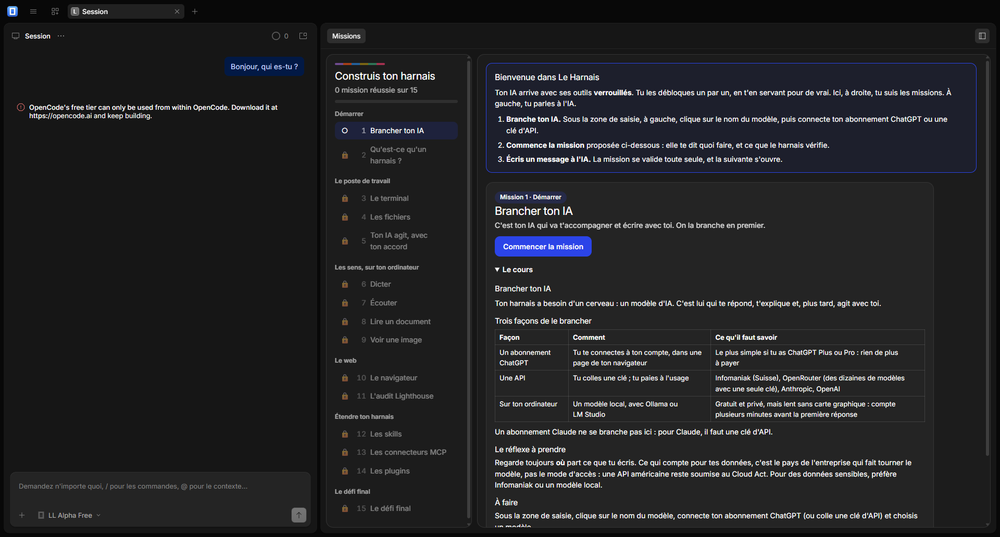

# Le Harnais

**Apprendre l'IA en débloquant ses outils un par un.** Une application de bureau où l'IA arrive avec son terminal, ses fichiers, son navigateur, sa voix et sa vue **verrouillés**. L'élève les débloque en s'en servant pour de vrai, et l'IA gagne des droits à mesure : lire, puis proposer, puis agir avec son accord.



> **État :** utilisable sur Windows 10 et 11, en bêta. Les 15 missions sont jouées de bout en bout dans l'application. Ce qui reste à faire (signature, macOS, mises à jour) est dans la [feuille de route](docs/feuille-de-route.md).

## À quoi sert ce dépôt

Un formateur veut que des débutants comprennent ce qu'il y a **derrière** une IA qui « sait tout faire » : un cerveau (le modèle), des outils, des droits, et eux qui décident. Plutôt que de l'expliquer, on leur fait vivre :

- tout est installé, mais fermé ;
- chaque outil s'ouvre par une **mission** : lancer une commande, lire un scan, auditer un site ;
- le harnais **vérifie l'action** (le terminal, un fichier, un appel d'outil), valide la mission toute seule, puis l'outil reste ouvert ;
- l'IA est branchée dès la première minute et sert de prof, mais elle ne modifie jamais le logiciel : elle travaille dans le dossier de l'élève, avec les droits qu'il a gagnés.

Ce dépôt contient l'application, les 15 missions du parcours débutant, et tout pour les modifier, les réordonner ou en écrire de nouvelles.

## Démarrer de A à Z

Choisis ton rôle.

### Je suis élève

Suis le guide pas à pas, avec captures d'écran : **[docs/demarrer-eleve.md](docs/demarrer-eleve.md)**. En résumé :

1. Télécharge l'archive `le-harnais-<version>-win-x64.zip` (page *Releases* du dépôt) et décompresse-la.
2. Double-clique sur `Lancer-Le-Harnais.bat`.
3. Branche ton IA (ton abonnement ChatGPT, ou une clé d'API), écris « Bonjour ».
4. Le panneau des missions s'ouvre : suis-les dans l'ordre.

### Je suis formateur

Prépare ta classe avec **[docs/formateur.md](docs/formateur.md)** : ce qu'il faut sur les ordinateurs, quelle IA brancher, ce qui se passe côté données, et que faire quand Windows bloque. Pour changer le contenu : **[docs/ecrire-une-mission.md](docs/ecrire-une-mission.md)**.

### Je suis développeur

Prérequis : [Bun](https://bun.sh) 1.4 ou plus, Node.js 24, Git.

```bash
git clone <ce dépôt> && cd le-harnais
bun install
bun run test         # 51 tests : moteur, plugin, extension
bun run verifier     # le parcours est-il cohérent ?
bun run dev          # lance l'application en développement (prépare OpenCode, construit le plugin)
bun scripts/empaqueter.ts   # construit l'archive pour Windows
```

Tout est détaillé dans **[docs/developper.md](docs/developper.md)** (dont les pièges sous Windows), l'architecture dans **[docs/architecture.md](docs/architecture.md)**, et la montée de version d'OpenCode dans **[docs/mettre-a-jour-opencode.md](docs/mettre-a-jour-opencode.md)**.

## Le parcours débutant

| Chapitre | Missions |
| --- | --- |
| Démarrer | 1 Brancher ton IA · 2 Qu'est-ce qu'un harnais ? |
| Le poste de travail | 3 Le terminal · 4 Les fichiers · 5 Ton IA agit, avec ton accord |
| Les sens, sur ton ordinateur | 6 Dicter · 7 Écouter · 8 Lire un document · 9 Voir une image |
| Le web | 10 Le navigateur · 11 L'audit Lighthouse |
| Étendre ton harnais | 12 Les skills · 13 Les connecteurs MCP · 14 Les plugins |
| Le défi final | 15 Le dossier Exemple, de bout en bout |

Les voix, la lecture de documents et la vue **tournent sur l'ordinateur de l'élève** : Whisper pour la voix, Tesseract pour les scans, un modèle de détection pour les images. Rien ne part en ligne, sauf ce que l'élève choisit d'envoyer à son IA.

## Modulaire par construction

Une mission n'a jamais de numéro : elle a un nom (`terminal`, `dicter`…). L'ordre vit dans un fichier de parcours à part. Déplacer ou insérer une mission revient à déplacer ou ajouter une ligne ; les numéros se recalculent, et la progression des élèves, rangée par nom, ne se perd pas. Le vérificateur refuse un ordre impossible et dit pourquoi :

```text
✗ « lire-scan » a besoin de « fichiers.ia.lire », débloquée par « fichiers », qui vient après. Déplacez l'une des deux.
```

## Construit sur OpenCode

L'application est [OpenCode Desktop](https://github.com/anomalyco/opencode) (licence MIT), figé sur une version, avec notre surcouche. On garde son cœur intact pour suivre ses mises à jour : nos modifications tiennent dans 8 petits patchs.

| Dossier | Contenu |
| --- | --- |
| `packages/moteur` | Le cœur modulaire : capacités, missions, parcours, preuves, droits. Sans dépendance à OpenCode. |
| `packages/plugin` | Le plugin du serveur d'OpenCode : droits de l'IA, journal, outils des sens, consignes du prof. |
| `packages/extension` | L'extension de la fenêtre : le panneau des missions, la dictée, les moteurs des sens. |
| `contenus/` | Les missions et les parcours, en YAML et Markdown. |
| `upstream/` | La version figée d'OpenCode, nos patchs et la configuration d'empaquetage. |
| `marque/` | L'icône et son script de dessin. |
| `scripts/` | Préparer OpenCode, lancer en développement, empaqueter, capturer l'application. |
| `docs/` | Guides, architecture, feuille de route, questions ouvertes. |

## Limites connues

- **Windows seulement** pour l'instant (macOS n'est pas fait).
- **Non signé** : le contrôle intelligent des applications de Windows 11 peut refuser de le lancer ([détails](docs/formateur.md#si-windows-bloque-lapplication)).
- **Le modèle gratuit d'OpenCode n'y répond pas** : l'élève branche son propre fournisseur.
- Un modèle **local** sur un PC sans carte graphique est lent : compte plusieurs minutes avant la première réponse.

## Contribuer, licences

Les règles du dépôt (écrire en français, tenir le [CHANGELOG](CHANGELOG.md), pas de documentation obsolète) sont dans [CLAUDE.md](CLAUDE.md). Code sous MIT, contenus sous CC BY-NC 4.0, OpenCode sous sa propre licence MIT : voir [LICENSE.md](LICENSE.md).
