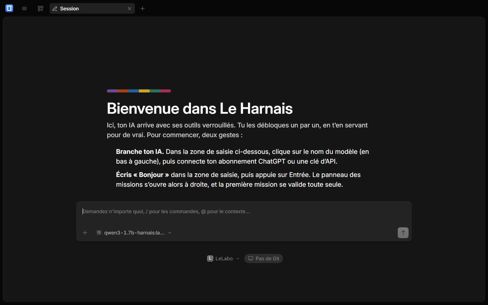
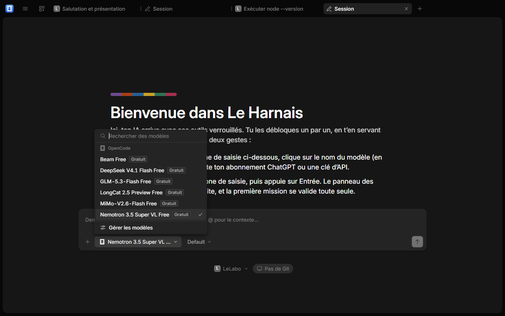
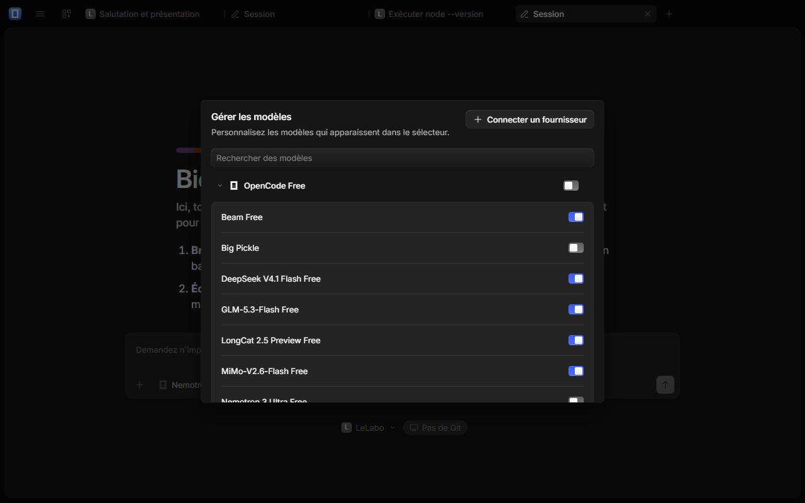
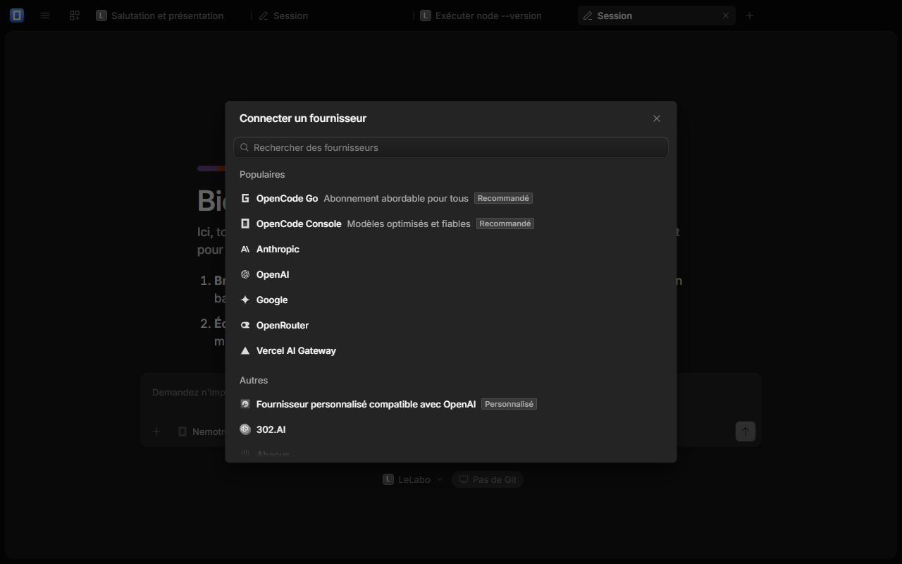
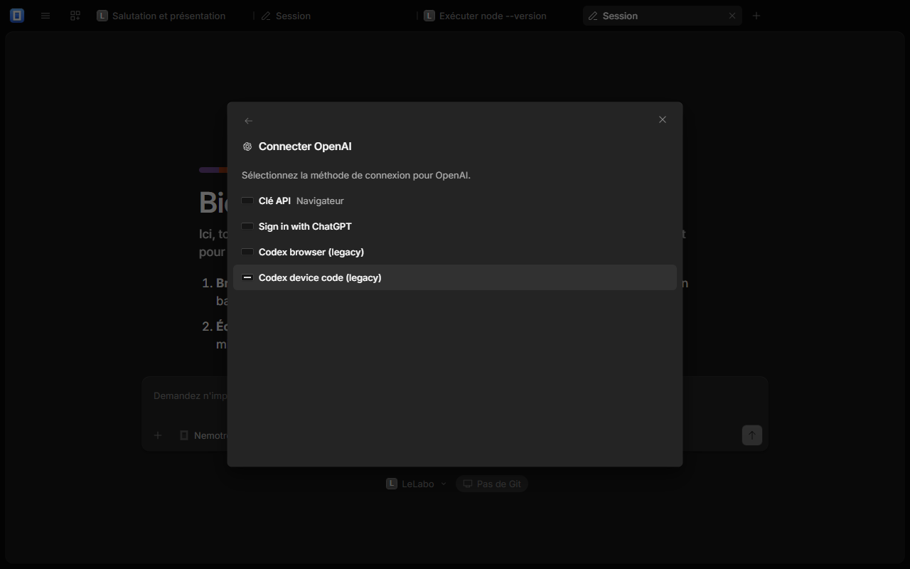
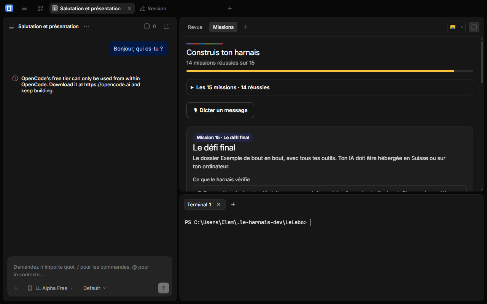
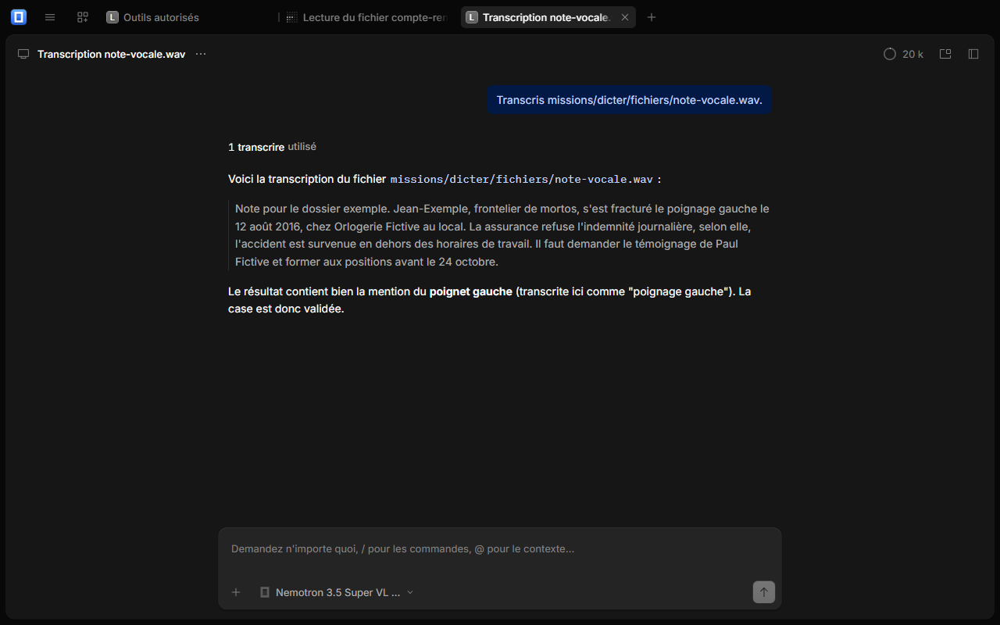

# Démarrer avec Le Harnais, de A à Z

> **Prototype, pas fini.** Le Harnais est une version 0.1.0 en bêta : des défauts sont possibles, sans garantie ni assistance. Il ne fonctionne que sur **Windows 10 ou 11**, il n'est pas signé (Windows 11 peut le bloquer), et il se met à jour à la main. N'y mets que des **données fictives**.

Le Harnais est une **surcouche d'[OpenCode](https://opencode.ai)** (licence MIT) : l'application est celle d'OpenCode, avec nos missions par-dessus, pour que tu comprennes comment fonctionne un harnais. Ce n'est pas un produit officiel d'OpenCode.

Ce guide est pour toi qui découvres l'IA. Il te faut un ordinateur **Windows 10 ou 11**, une connexion internet, et un abonnement ChatGPT **ou** une clé d'API d'un fournisseur d'IA (ton formateur te dit lequel).

## 1. Installer

Choisis **une** des deux façons. La première est la plus simple.

### A. L'installateur automatique (recommandé)

1. Télécharge deux fichiers depuis la page *Releases* du dépôt, dans le **même dossier** : `Installer-Le-Harnais.bat` et `installer.ps1`.
2. Double-clique sur **`Installer-Le-Harnais.bat`**. Si Windows affiche « Windows a protégé votre ordinateur », clique sur *Informations complémentaires* puis *Exécuter quand même*.
3. Attends : l'installateur télécharge Le Harnais (environ 0,9 Go), l'installe dans `%LOCALAPPDATA%\LeHarnais`, crée un raccourci **Le Harnais** sur ton bureau et l'ouvre.

Pas de droits d'administrateur. Pour le relancer plus tard : le raccourci du bureau. Pour mettre à jour : relance l'installateur (tes conversations et ta progression sont conservées).

Variante en une ligne, dans une fenêtre PowerShell (si ton formateur te l'indique) :

```powershell
irm https://raw.githubusercontent.com/clement8426/le-harnais/main/installer/installer.ps1 | iex
```

### B. À la main, avec l'archive

1. Télécharge `le-harnais-<version>-win-x64.zip` (ton formateur te donne le lien, ou la page *Releases*).
2. Clic droit sur le fichier, **Extraire tout…**, et choisis un dossier simple, par exemple `C:\LeHarnais`.
3. Dans le dossier extrait, double-clique sur **`Lancer-Le-Harnais.bat`** (ou sur `Le Harnais.exe`, c'est la même chose).

Dans les deux cas, rien n'est installé dans Windows : l'application vit dans son dossier. Pour la retirer : `Desinstaller-Le-Harnais.bat` (de l'installateur), ou supprime le dossier.

> **Premier lancement :** compte une trentaine de secondes. Si Windows affiche « Une stratégie de contrôle d'application a bloqué ce fichier », dis-le à ton formateur : [la page qui l'explique](formateur.md#si-windows-bloque-lapplication).

## 2. L'écran de départ



Tu vois l'accueil du Harnais et, juste en dessous, la zone de saisie. Le projet **LeLabo** est ton atelier : l'application l'a créé dans tes *Documents*. L'IA ne travaillera que là.

## 3. Brancher ton IA

Sous la zone de saisie, clique sur **le nom du modèle**. La liste des modèles s'ouvre.



Tout en bas de la liste, clique sur **Gérer les modèles**. Une fenêtre s'ouvre : en haut à droite, le bouton **Connecter un fournisseur**.



Clique dessus : la liste des fournisseurs apparaît. Les plus courants :



- **OpenAI**, pour utiliser ton **abonnement ChatGPT** (choisis « Sign in with ChatGPT » : une page de ton navigateur s'ouvre, clique sur *Autoriser*, puis reviens dans l'application) ou une **clé d'API** (« Clé API »).
- **Anthropic** (Claude), **Google** (Gemini), **OpenRouter** (des dizaines de modèles avec une seule clé) : colle ta **clé d'API**.



Une fois connecté, ferme la fenêtre et choisis un modèle de ce fournisseur dans le menu. Un abonnement Claude ne se branche pas ici (Anthropic ne le permet pas) : pour Claude, il faut une clé d'API.

> Le modèle « Gratuit » d'OpenCode **ne répond pas** dans Le Harnais. Si tu écris à l'IA avant de t'être branché, tu vois un message d'erreur : c'est normal, branche ton IA.

## 4. Écrire « Bonjour »

Écris ton premier message et envoie-le. **Le panneau des missions s'ouvre tout seul à droite.**


À gauche, tu parles à l'IA. À droite, deux volets :

- **la liste des 15 missions**, rangée par chapitre. Les cadenas, ce sont les missions que tu n'as pas encore débloquées ;
- **la mission en cours** : ce qu'on t'explique, ce que le harnais vérifie (une case se coche quand c'est fait), des questions, et un indice si tu bloques.

## 5. Faire une mission

La première mission, « Brancher ton IA », se valide toute seule dès que ton IA t'a répondu. Ensuite :

1. Lis le cours de la mission en cours (elle s'ouvre toute seule : rien à démarrer).
2. Fais ce qui est demandé (écrire à l'IA, lancer une commande, ouvrir un fichier…).
3. Les preuves se cochent toutes seules. Quand elles sont toutes vertes, un bandeau jaune annonce **Mission réussie** et la suivante s'ouvre.

Ton IA gagne un droit à chaque mission. Si elle veut faire quelque chose qu'elle n'a pas encore gagné (par exemple lire un fichier), le harnais le lui refuse et te l'explique.

> **Mission 3, le terminal :** pour l'ouvrir, tape `/terminal` puis Entrée dans la zone de saisie (le terminal s'ouvre en bas de la fenêtre). Les trois commandes se tapent **dans le terminal**, pas dans la conversation : si c'est l'IA qui les lance, ou si tu les passes par « + > commande shell » de la zone de saisie, la mission ne les compte pas.



## 6. Les missions

| Mission | Ce que tu fais | Capture |
| --- | --- | --- |
| 1. Brancher ton IA | Brancher un modèle et recevoir sa première réponse | [voir](images/m01-brancher-ia.png) |
| 2. Qu'est-ce qu'un harnais ? | Comprendre ce qu'il y a autour d'un modèle | [voir](images/m02-harnais-c-est-quoi.png) |
| 3. Le terminal | Lancer trois vraies commandes | [voir](images/m03-terminal.png) |
| 4. Les fichiers | Explorer ton atelier, ouvrir un fichier | [voir](images/m04-fichiers.png) |
| 5. Ton IA agit, avec ton accord | Accepter ou refuser ce que l'IA propose | [voir](images/m05-ia-et-terminal.png) |
| 6. Dicter | Transformer une voix en texte, sur ton ordinateur | [voir](images/m06-dicter.png) |
| 7. Écouter | Faire lire un résumé à voix haute | [voir](images/m07-ecouter.png) |
| 8. Lire un document | Extraire le texte d'un scan, et le corriger | [voir](images/m08-lire-scan.png) |
| 9. Voir une image | Faire détecter les objets d'une photo | [voir](images/m09-voir-image.png) |
| 10. Le navigateur | Faire ouvrir une page à l'IA | [voir](images/m10-navigateur.png) |
| 11. L'audit Lighthouse | Mesurer la qualité d'un site | [voir](images/m11-audit-lighthouse.png) |
| 12. Les skills | Apprendre une recette à ton IA | [voir](images/m12-skills.png) |
| 13. Les connecteurs MCP | Brancher un outil externe | [voir](images/m13-mcp-lighthouse.png) |
| 14. Les plugins | Ajouter une mémoire au dossier de code | [voir](images/m14-plugins-graphify.png) |
| 15. Le défi final | Traiter un dossier complet de A à Z | [voir](images/m15-defi-dossier-exemple.png) |



## 7. Quand ça ne marche pas

| Ce que tu vois | Ce qu'il faut faire |
| --- | --- |
| « OpenCode's free tier can only be used from within OpenCode » | Tu n'as pas branché ton IA : reprends l'étape 3 |
| Une mission ne se coche pas | Relis la preuve : elle dit ce qui manque. Ouvre « Je bloque : un indice » |
| L'IA répond qu'elle n'a pas le droit | C'est voulu : elle gagnera ce droit à une mission suivante |
| « Managed service port … is already in use » | Normalement l'application se répare toute seule (compte jusqu'à 30 secondes au lancement). Sinon : ferme complètement l'application (fenêtre et barre des tâches), attends 10 secondes, relance ; si ça persiste, redémarre l'ordinateur |
| La dictée ne démarre pas | Autorise le micro dans Windows (*Paramètres > Confidentialité > Microphone*). Le micro peut mettre quelques secondes à s'ouvrir |
| La première dictée ou lecture de scan est très lente | Normal : le modèle se télécharge la première fois (internet), puis il reste sur ton ordinateur |
| Un modèle local met plusieurs minutes à répondre | Normal sans carte graphique. Préfère ChatGPT ou une API |

## 8. Tes données

- Tout ce que tu fais est dans `Documents\LeLabo` (ton atelier) et dans `%APPDATA%\app.leharnais.desktop` (réglages et conversations).
- **Ce que tu écris à l'IA part chez son fournisseur** : regarde toujours où. Pour des données sensibles, préfère un fournisseur suisse (Infomaniak) ou un modèle local. C'est le sujet du défi final.
- La voix, la lecture de scans et la détection d'images **restent sur ton ordinateur**.
